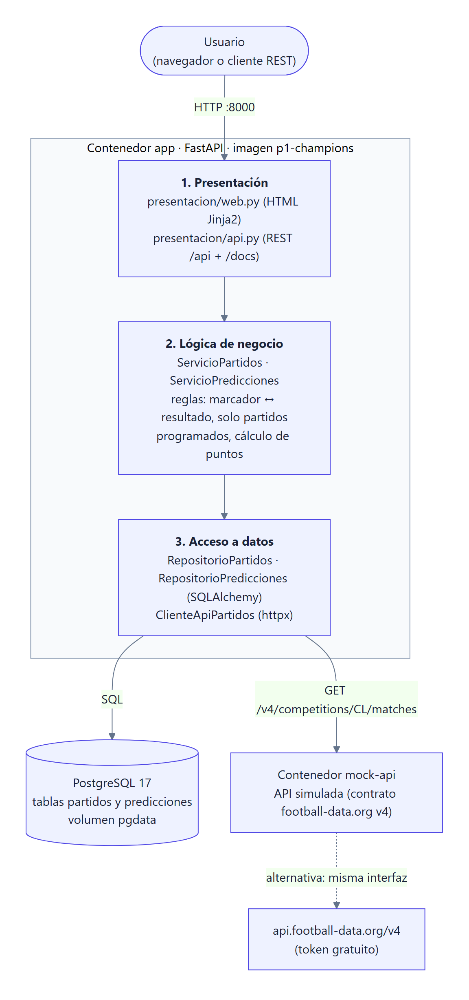
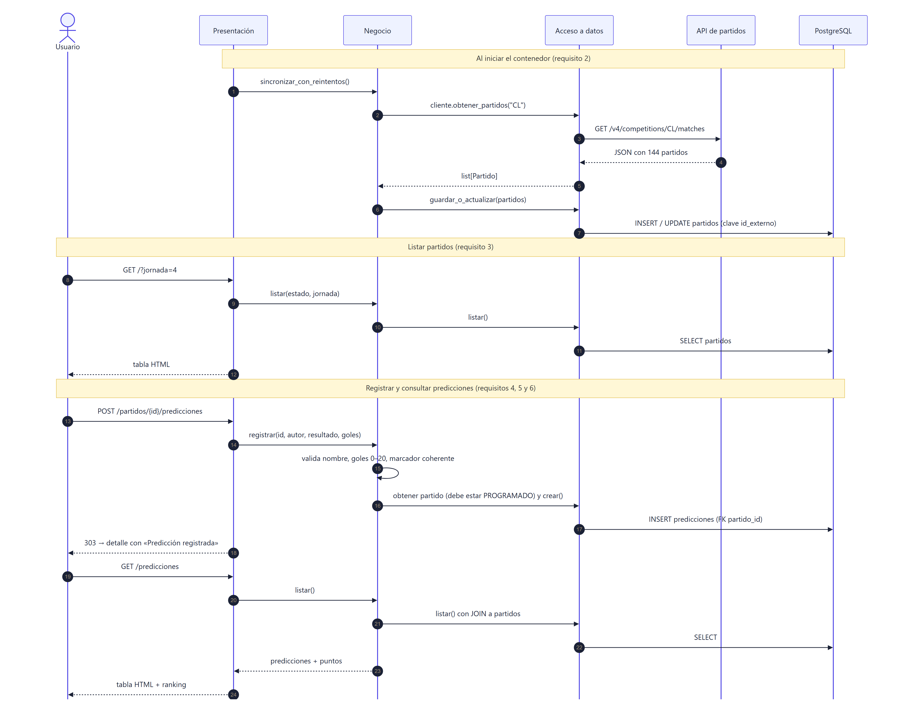
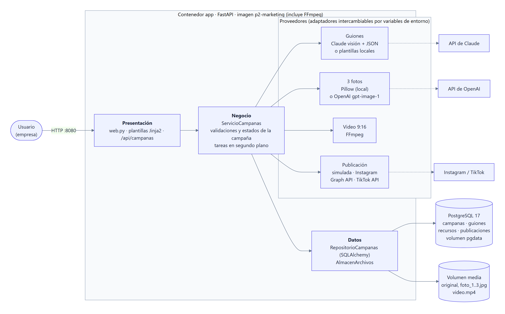
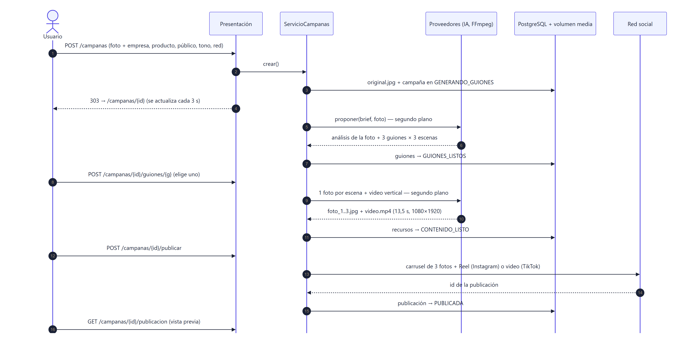

# Arquitectura y flujo de datos

## Pregunta 1: predicciones de la Champions League (3 capas)



Las capas solo dependen de la capa de abajo: presentación → negocio → datos. Las entidades de `app/dominio/` (`Partido`, `Prediccion`, `Resultado`, `EstadoPartido`) son clases Python puras que comparten las tres capas. `app/main.py` es la raíz de composición: crea el motor de BD, los repositorios, el cliente de la API y los servicios, y se los entrega a la presentación.

| Capa | Archivos | Responsabilidad |
|---|---|---|
| Presentación | `presentacion/web.py`, `presentacion/api.py`, `templates/`, `static/` | Recibir las peticiones HTTP, validar el formato de los datos (formularios y JSON) y mostrar HTML o JSON. No contiene reglas ni SQL. |
| Lógica de negocio | `negocio/servicios.py` | Sincronizar partidos; reglas de las predicciones: nombre obligatorio, goles entre 0 y 20, marcador coherente con el resultado elegido y solo partidos `PROGRAMADO`; puntos: 3 por marcador exacto, 1 por resultado, 0 si falla. |
| Acceso a datos | `datos/db.py`, `datos/modelos.py`, `datos/repositorios.py`, `datos/cliente_api_partidos.py` | Tablas ORM, consultas SQL (SQLAlchemy) y consumo HTTP de la API de partidos (httpx). Traduce entre filas o JSON y entidades de dominio. |

### Modelo de datos (PostgreSQL)

```
partidos                                   predicciones
─────────────────────────────              ──────────────────────────────────
id            PK                    ┌────< partido_id      FK → partidos.id
id_externo    UNIQUE (id de la API) │      id              PK
competicion, etapa, jornada         │      autor
fecha_utc, estado                   │      resultado       CHECK LOCAL|EMPATE|VISITANTE
equipo_local, equipo_visitante      │      goles_local     CHECK >= 0
goles_local, goles_visitante        │      goles_visitante CHECK >= 0
actualizado_en                      │      creado_en
```

### Flujo de datos



1. **Arranque.** El evento `lifespan` de FastAPI crea las tablas y llama a `ServicioPartidos.sincronizar_con_reintentos()`. El cliente hace `GET {API_PARTIDOS_URL}/competitions/CL/matches`, convierte el JSON en entidades `Partido` y el repositorio inserta los nuevos o actualiza los existentes usando `id_externo`. Por eso sincronizar varias veces no duplica partidos y sí actualiza los resultados. Si la API no responde, reintenta 10 veces y la app arranca con lo que ya tenga guardado.
2. **Listado.** `GET /` o `GET /api/partidos?estado=&jornada=` → servicio → repositorio → `SELECT` → tabla HTML o JSON.
3. **Registro de una predicción.** `POST /partidos/{id}/predicciones` (formulario) o `POST /api/predicciones` (JSON) → el servicio valida las reglas → el repositorio comprueba que el partido exista y esté programado, y hace `INSERT` en `predicciones`, asociada por FK al partido.
4. **Consulta.** `GET /predicciones` o `GET /api/predicciones` → `SELECT` con `JOIN` a `partidos` → el servicio calcula los puntos si el partido ya terminó → tabla y ranking.

### API REST

| Método | Ruta | Descripción |
|---|---|---|
| GET | `/api/partidos?estado=PROGRAMADO&jornada=4` | Lista los partidos guardados |
| GET | `/api/partidos/{id}` | Detalle de un partido |
| POST | `/api/sincronizar` | Vuelve a consumir la API y actualiza la BD |
| GET | `/api/predicciones?partido_id=` | Lista las predicciones (con puntos) |
| POST | `/api/predicciones` | `{"partido_id", "autor", "resultado", "goles_local", "goles_visitante"}` |
| GET | `/health` | Estado de la BD y número de partidos (lo usa el healthcheck de Docker) |

### API simulada (`mock_api`)

Imita el contrato de `api.football-data.org/v4` (los mismos campos: `matches[].homeTeam.name`, `score.fullTime.home`, `status`, etc.). Genera la fase liga: 36 equipos, 8 jornadas y 144 partidos, sin rivales repetidos (método del círculo). El calendario se ancla a la fecha de arranque: las jornadas 1–3 ya se jugaron y las 4–8 están programadas, así que siempre hay partidos para predecir. Los marcadores son pseudoaleatorios pero deterministas. Con `MOCK_FECHA_ANCLA=AAAA-MM-DD` se fija el calendario; por ejemplo, para la demostración se adelantó la jornada 4 y así se vio el cálculo de puntos. **Los datos son simulados.**

---

## Pregunta 2: marketing con IA para empresas



| Capa | Archivos | Responsabilidad |
|---|---|---|
| Presentación | `presentacion/web.py`, `templates/` | Formulario con la subida de la foto, la página de la campaña (que se actualiza sola mientras hay trabajo en curso), la vista previa de la publicación y `/api/campanas`. |
| Negocio | `negocio/servicio_campanas.py` | Valida el brief y la foto (tipo, tamaño ≤ 10 MB, mínimo 300 px, orientación EXIF), controla los estados y lanza los pasos en segundo plano. |
| Proveedores | `proveedores/guiones.py`, `imagenes.py`, `video.py`, `redes.py` | Adaptadores intercambiables: Claude o plantillas; Pillow u OpenAI; FFmpeg; publicación simulada, Instagram Graph API o TikTok Content Posting API. |
| Datos | `datos/repositorio.py`, `datos/almacen.py` | Tablas `campanas`, `guiones`, `recursos` y `publicaciones` en PostgreSQL. Los archivos van en el volumen `media`. |

### Estados de una campaña

```
GENERANDO_GUIONES → GUIONES_LISTOS → GENERANDO_CONTENIDO → CONTENIDO_LISTO → PUBLICANDO → PUBLICADA
        └──────────────── ERROR (con botón «Reintentar») ──────────┘
```

Si el contenedor se reinicia a mitad de una tarea, al arrancar la campaña pasa a `ERROR` y se puede reintentar.

### Flujo de datos



1. **Foto + brief.** La foto se valida, se corrige la orientación y se guarda como `campanas/<id>/original.jpg` en el volumen. También se extrae la paleta de colores (cuantización), que luego define el color de acento de los diseños.
2. **3 guiones.** Con `ANTHROPIC_API_KEY`, Claude (`claude-opus-5-5`) recibe la foto y el brief y responde con **salida estructurada** (JSON Schema): una descripción de la foto y 3 guiones con distinto enfoque. Cada guion trae título, enfoque, gancho, 3 escenas (texto en pantalla, descripción visual, narración), CTA, caption y hashtags. Sin clave, se usan plantillas a partir del brief y del análisis de color.
3. **Elección y generación.** Por cada escena del guion elegido se diseña una pieza de 1080×1350: gancho a sangre completa, beneficio en tarjeta y cierre con CTA. Con OpenAI, primero se genera una foto nueva por escena a partir de la original. FFmpeg arma el video de 1080×1920 con zoom lento (Ken Burns), transiciones *fade*, una tarjeta final con la marca y el CTA, y pista de audio AAC.
4. **Publicación.** En modo simulado se guarda el registro y se muestra la vista previa. En modo real, para Instagram se crean 3 contenedores de imagen, luego un contenedor `CAROUSEL` y su `media_publish`, y después un contenedor `REELS` que se espera hasta `FINISHED` antes de su `media_publish`. Para TikTok: `video/init` (FILE_UPLOAD), `PUT` del archivo y consulta de estado.

---

## Contenedores, imágenes y volúmenes

| Imagen | Base | Contenido |
|---|---|---|
| `p1-champions` | `python:3.12-slim` | App de 3 capas, usuario sin privilegios, `HEALTHCHECK` contra `/health` |
| `p1-mock-api` | `python:3.12-slim` | API simulada |
| `p2-marketing` | `python:3.12-slim` + `ffmpeg` + `fonts-dejavu-core` | App de marketing |
| `postgres:17-alpine` | oficial | Una base de datos por aplicación, con `pg_isready` como healthcheck |

| Volumen | Montado en | Qué guarda |
|---|---|---|
| `pgdata` (P1) | `/var/lib/postgresql/data` | partidos y predicciones |
| `pgdata` (P2) | `/var/lib/postgresql/data` | campañas, guiones, recursos y publicaciones |
| `media` (P2) | `/data/media` | fotos originales y generadas, y videos |

Toda la configuración entra por **variables de entorno**. `docker-compose.yml` las lee de `.env`, que no se versiona; `.env.example` documenta cada una. La app espera a que la BD (y en P1 la API simulada) esté *healthy* gracias a `depends_on: condition: service_healthy`.
