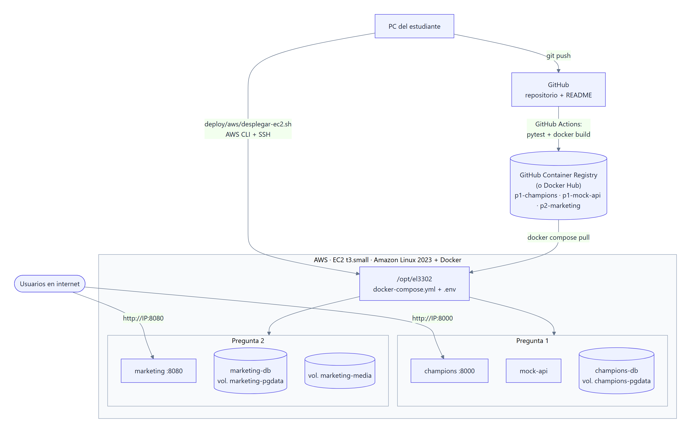

# Despliegue en AWS (EC2 + Docker Compose)



Las dos aplicaciones corren en **una sola instancia EC2** (Amazon Linux 2023, `t3.small`, 20 GB gp3) con Docker Compose. El servidor no compila nada: descarga las imágenes publicadas en GHCR o en Docker Hub.

| Recurso | Valor |
|---|---|
| Instancia | `t3.small` (2 vCPU, 2 GB), más 2 GB de swap creados por `user-data.sh` |
| Puertos abiertos | `8000` (P1) y `8080` (P2) para todos; `22` (SSH) solo desde tu IP |
| Carpeta en el servidor | `/opt/el3302` con `docker-compose.yml` y `.env` |
| Costo aproximado | unos USD 0,02 por hora mientras está encendida. Bórrala con `eliminar.sh` al terminar. |

## 1. Publicar las imágenes

**Opción A: GitHub Container Registry (recomendada).**

1. Crea un repositorio en GitHub y sube el proyecto:
   ```bash
   git remote add origin https://github.com/<usuario>/el3302-lab5-contenedores.git
   git push -u origin main
   ```
2. En la pestaña **Actions**, espera a que el workflow *Publicar imágenes Docker* termine en verde. Toma una captura.
3. En tu perfil → **Packages**, abre `p1-champions`, `p1-mock-api` y `p2-marketing`. En cada uno: *Package settings* → *Change visibility* → **Public**. Toma una captura.

**Opción B: Docker Hub.**
```bash
docker login
bash scripts/publicar-imagenes.sh <usuario-dockerhub>
```

## 2. Configurar las credenciales de AWS

```bash
aws configure          # Access key, secret, región (ej. us-east-1)
aws sts get-caller-identity   # debe mostrar tu cuenta
```

Con AWS Academy / Learner Lab, copia las credenciales temporales de *AWS Details* → *AWS CLI* en `~/.aws/credentials`. Incluyen `aws_session_token` y vencen al cerrar el laboratorio.

## 3. Variables del servidor

```bash
cp deploy/nube.env.example deploy/nube.env
```

Completa por lo menos:

```env
IMAGE_PREFIX=ghcr.io/<usuario>     # o tu usuario de Docker Hub
P1_DB_PASSWORD=<una clave larga>
P2_DB_PASSWORD=<otra clave larga>
```

Opcionales: `ANTHROPIC_API_KEY` (guiones con Claude), `OPENAI_API_KEY` + `PROVEEDOR_IMAGENES=openai`, y `MODO_PUBLICACION=real` con las credenciales de Instagram o TikTok. Si dejas `URL_PUBLICA` vacía, el script la completa con `http://<ip>:8080`.

## 4. Desplegar

```bash
bash deploy/aws/desplegar-ec2.sh
```

El script:

1. Verifica la cuenta (`aws sts get-caller-identity`).
2. Crea el par de llaves `el3302-lab5` y lo guarda en `deploy/aws/.estado/`, que no se sube a Git.
3. Crea el grupo de seguridad `el3302-lab5` en la VPC por defecto.
4. Lanza la EC2 con la AMI más reciente de Amazon Linux 2023. `user-data.sh` instala Docker y el plugin de Compose.
5. Espera a que Docker esté listo y copia por `scp` el `docker-compose.yml` y el `.env`.
6. Ejecuta `docker compose pull && docker compose up -d` y muestra las URL.

### Alternativa manual (consola web)

1. EC2 → *Launch instance*: Amazon Linux 2023, `t3.small`, un par de llaves nuevo, y un grupo de seguridad con los puertos 22 (tu IP), 8000 y 8080. En *Advanced details* → *User data*, pega `deploy/aws/user-data.sh`.
2. Conéctate: `ssh -i llave.pem ec2-user@<ip>`.
3. Copia `deploy/docker-compose.nube.yml` como `/opt/el3302/docker-compose.yml` y tu `nube.env` como `/opt/el3302/.env`.
4. Ejecuta `cd /opt/el3302 && sudo docker compose up -d`.

## 5. Evidencias para el informe

| Captura | Cómo obtenerla |
|---|---|
| Workflow de GitHub Actions en verde | pestaña Actions del repositorio |
| Paquetes publicados (públicos) | GitHub → Packages, o Docker Hub → Repositories |
| Instancia EC2 en *Running* con su IP pública | consola de EC2 → Instances |
| Grupo de seguridad con los puertos 8000/8080 | EC2 → Security Groups → Inbound rules |
| `docker compose ps` en el servidor | `ssh ... "cd /opt/el3302 && sudo docker compose ps"` |
| P1 funcionando en `http://<ip>:8000` | partidos, una predicción nueva y la lista de predicciones |
| P2 funcionando en `http://<ip>:8080` | campaña completa: guiones → contenido → publicación |
| Persistencia | `sudo docker compose restart` y mostrar que los datos siguen |

## 6. Actualizar y eliminar

```bash
bash deploy/aws/actualizar.sh   # tras un nuevo push: descarga las imágenes nuevas y reinicia
bash deploy/aws/eliminar.sh     # termina la instancia y borra el grupo de seguridad y el par de llaves
```

## Problemas frecuentes

| Síntoma | Solución |
|---|---|
| `pull access denied` en el servidor | Los paquetes de GHCR siguen privados: hazlos públicos (paso 1.3), o en el servidor ejecuta `docker login ghcr.io` con un token que tenga el permiso `read:packages`. |
| `InvalidClientTokenId` | Las credenciales de AWS vencieron: vuelve a ejecutar `aws configure` o copia las nuevas de AWS Academy. |
| No abre `http://<ip>:8000` | Revisa el grupo de seguridad y que estés usando `http://`, no `https://`. |
| SSH bloqueado | Tu IP cambió: agrega la nueva al puerto 22 del grupo de seguridad. |
| Instagram no publica | `URL_PUBLICA` debe ser la IP o el dominio públicos, y la cuenta debe ser profesional y estar vinculada a una app de Meta con el permiso `instagram_content_publish`. |
